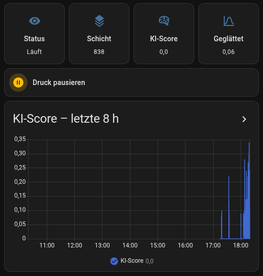
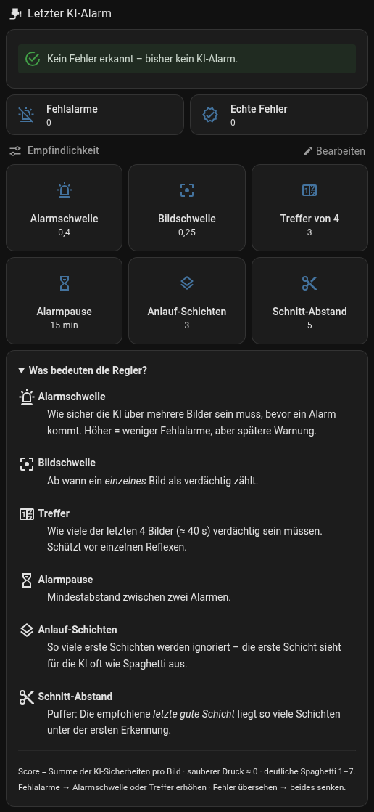

# bambu-print-guard

**Lokale, kostenlose KI-Fehlererkennung für Bambu-Lab-Drucker in Home Assistant.**

[](#druckermodus-lan-only--developer-modus)

> [!IMPORTANT]
> **Gemacht für Bambu-Lab-Drucker im _LAN-only-Modus_ mit eingeschaltetem _Developer-Modus_.**
> Home Assistant spricht lokal mit dem Drucker (ha-bambulab, lokales MQTT) – ohne Bambu-Cloud.
> Der Developer-Modus ist nötig, damit Home Assistant Befehle wie **Pausieren / Fortsetzen**
> senden darf. Mit Cloud verbundene Drucker sind nicht getestet.
> Für Alarme mit Bild unterwegs braucht Home Assistant Fernzugriff – getestet mit
> **Home Assistant Cloud** (Nabu Casa).

*English: [README.md](README.md)* · 📖 **[Wiki](https://github.com/noskillor/bambu-print-guard/wiki/Deutsch)** – ausführliche Anleitungen, FAQ

bambu-print-guard beobachtet während eines Drucks die Druckerkamera, erkennt Spaghetti,
abgelöste Teile und Klumpen mit dem Open-Source-Modell von
[Obico](https://github.com/TheSpaghettiDetective/obico-server) und schickt eine
**Push-Nachricht mit Knöpfen** über die Home-Assistant-App:

- 📸 Foto mit markierter Fehlerstelle
- 🔢 Schicht, ab der der Fehler begann, mit **exakter Z-Höhe** aus dem G-Code
- ✂️ **letzte gute Schicht** – dort in Bambu Studio / Orca schneiden, Rest drucken, ankleben
- ⏸️ **Pausieren / Fortsetzen** direkt in der Nachricht
- 🧠 Live-Ansicht, was die KI sieht, und Score-Verlauf im Dashboard

Alles läuft lokal: keine Cloud, kein Abo, keine Grafikkarte nötig. Funktioniert mit
Druckern im **LAN-only- / Developer-Modus**.

## Screenshots

<p align="center">
  
  
</p>

## Funktionsweise

1. Solange der Drucker `running` meldet, holt der Guard alle 10 s ein Kamerabild aus HA.
2. Das Obico-Modell liefert Fundstellen mit Wahrscheinlichkeit → Score pro Bild.
3. Der Score wird geglättet; für einen Alarm müssen mehrere Bilder hintereinander
   auffällig sein – einzelne Reflexe lösen nichts aus.
4. Bei einem Alarm ruft der Guard einen HA-Webhook auf; das Blueprint lädt das Bild
   und verschickt die Nachricht.

Gemessen auf einer älteren Intel-Core-i5-Desktop-CPU (2 Kerne zugewiesen): ~0,35 s pro Bild, ~360 MB RAM für das Modell.

## Voraussetzungen

- Home Assistant mit [ha-bambulab](https://github.com/greghesp/ha-bambulab) (auch im
  LAN-only-Modus) und der Companion-App auf dem Handy
- **Fernzugriff auf Home Assistant** für Alarme unterwegs – z. B. **Home Assistant Cloud
  (Nabu Casa)**, damit ist das Projekt getestet. Die Push-Nachricht kommt immer an, aber
  **Alarmbild** und **Dashboard** beim Antippen lädt das Handy aus deinem Home Assistant – ohne
  Fernzugriff klappt das nur zu Hause. Der Drucker bleibt in jedem Fall LAN-only.
- Ein Rechner mit Docker *oder* Debian (Proxmox-LXC, VM, NAS, Mini-PC, Raspberry Pi 4/5),
  ca. 1 GB freier RAM während des Drucks
- Getestet mit **P1S**; andere Bambu-Drucker sollten gehen, solange HA eine Kamera-Entität
  und einen Druckstatus-Sensor hat.

## Druckermodus: LAN-only + Developer-Modus

| Einstellung | Wozu |
|---|---|
| **LAN-only-Modus** | Home Assistant (ha-bambulab) liest Status, Schichten und Kamera direkt im Heimnetz vom Drucker |
| **Developer-Modus** | erlaubt Home Assistant, Befehle zu senden – nötig für *Pausieren* / *Fortsetzen*. Ohne ihn ignoriert der Drucker Befehle von Drittprogrammen |

Am Drucker: *Einstellungen → Netzwerk / WLAN → **LAN-only-Modus** an*, danach ***Developer-Modus*** an
(Menünamen je nach Modell und Firmware leicht unterschiedlich). Den angezeigten **Zugangscode**
notieren und beim Einrichten von ha-bambulab im *lokalen / LAN*-Modus verwenden.

Im LAN-only-Modus sind Bambu Handy und die Bambu-Cloud nicht verfügbar – gedruckt wird über
Bambu Studio / Orca Slicer im Netzwerk.

## Installation

**Variante A – Docker Compose (empfohlen)**

```bash
git clone https://github.com/noskillor/bambu-print-guard.git
cd bambu-print-guard
mkdir -p config data
cp config.example.json config/config.json   # Entitäts-IDs + public_url anpassen
nano config/ha_token                         # HA-Long-Lived-Token einfügen
docker compose up -d --build
```

**Variante B – Debian / Proxmox-LXC**

```bash
git clone https://github.com/noskillor/bambu-print-guard.git
cd bambu-print-guard
sudo bash deploy/lxc/install.sh
```

Optional startet der Proxmox-Host den Container nur während eines Drucks:
[docs/proxmox.md](docs/proxmox.md).

**Konfiguration:** In `config.json` mindestens die Entitäts-IDs deines Druckers und
`public_url` (Adresse, unter der HA den Guard erreicht, z. B. `http://192.168.1.50:8098`)
eintragen. Bei deutscher HA-Sprache heißen die Sensoren z. B. `sensor.<drucker>_druckstatus`,
`sensor.<drucker>_aktuelle_schicht`, `sensor.<drucker>_gesamtzahl_der_schichten`.
Alle Optionen: [docs/configuration.md](docs/configuration.md). Die Schwellen lassen sich
optional **live per Schieberegler in Home Assistant** einstellen (`ha_settings`, ohne Neustart).

**Home Assistant einrichten:** [docs/home-assistant.md](docs/home-assistant.md) –
ein Helfer, drei kleine Integrationen, zwei Blueprints, ein Dashboard-Reiter.

## Extras

- **Wächter** – Warnung, wenn gedruckt wird, der Guard aber schweigt
- **Zusammenfassung am Druckende** – „fertig, kein Fehler, höchster Score 0,22“
- **Feedback-Knöpfe** – Alarm als *Fehlalarm* / *echter Fehler* markieren, Zähler zeigen, ob die Schwellen passen
- **Bauraum-Licht** beim Drucken an, für zuverlässige Erkennung
- **Automatisches Aufräumen** von Alarmbildern und Verlauf nach 30 Tagen
- **Mehrere Drucker** – ein Guard pro Drucker: [docs/multiple-printers.md](docs/multiple-printers.md)
- Für den Token einen **eigenen HA-Benutzer ohne Admin-Rechte** verwenden – der Guard liest nur und nutzt Webhooks.

## Lizenzen & Danksagung

- Erkennungsmodell und ML-Dienst: **[Obico](https://github.com/TheSpaghettiDetective/obico-server)**
  (AGPL-3.0). Dieses Repository enthält **keinen** Obico-Code und keine Modelldateien; der
  Container wird beim Nutzer direkt aus dem offiziellen Obico-Repository gebaut. Kein offizielles
  Projekt von Obico oder Bambu Lab.
- Code in diesem Repository: [MIT-Lizenz](LICENSE).
