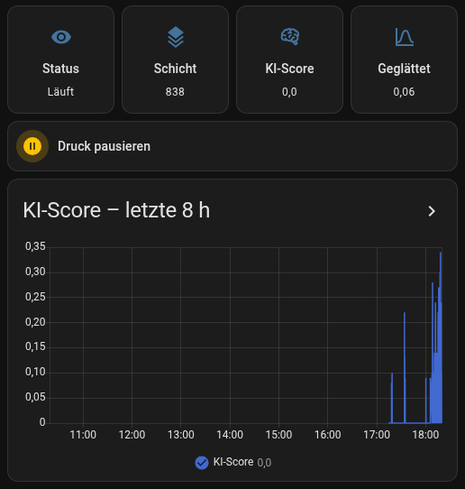
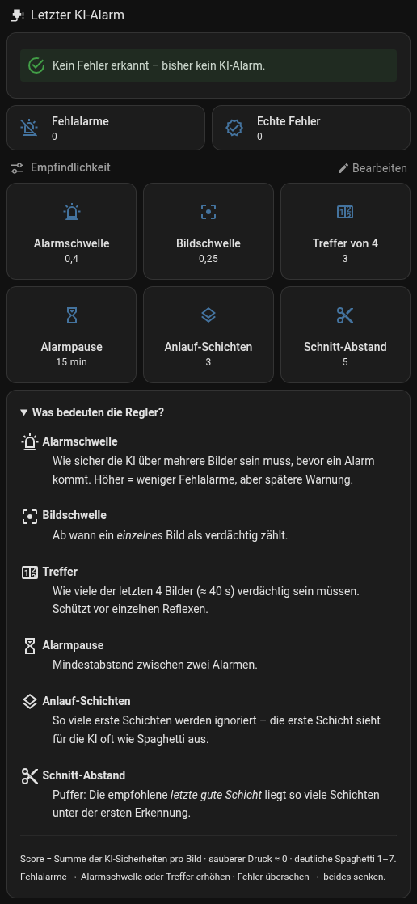

# bambu-print-guard

**Local, free AI failure detection for Bambu Lab printers in Home Assistant.**

[](https://github.com/noskillor/bambu-print-guard/actions/workflows/ci.yml)
[](LICENSE)

*Deutsche Anleitung: [README.de.md](README.de.md)*

bambu-print-guard watches your printer's camera while a print is running, detects
spaghetti, detached parts and blobs with the open-source [Obico](https://github.com/TheSpaghettiDetective/obico-server)
detection model, and sends an **actionable push notification** through the Home Assistant
Companion App:

- 📸 annotated photo with the suspicious area boxed
- 🔢 layer where the failure started, with the **exact Z height** from the G-code
- ✂️ **last good layer**, so you can cut the model there in Bambu Studio / Orca, print the rest and glue it on
- ⏸️ **Pause / Resume** buttons right in the notification
- 🧠 live view of what the AI sees and a score history graph in your dashboard

Everything runs locally: no cloud, no subscription, no GPU required. It works with
printers in **LAN-only / Developer mode**.

## Screenshots

<p align="center">
  
  
</p>

<sub>Example dashboard (German UI) – live AI image, status, score history, feedback counters, sensitivity and help.</sub>

## How it works

```
Home Assistant ──camera snapshot──► print_guard.py ──image──► Obico ML container (CPU)
      ▲                                  │   ◄──boxes + confidence──┘
      │                                  │ smoothing over several frames
      │                                  ▼
      └──── webhook (alert) ◄── annotated image, layer, Z height, last good layer
            score sensor + live.jpg
```

1. While the printer status is `running`, the guard fetches a camera snapshot every 10 s.
2. The Obico model returns detection boxes; their confidences form the frame score.
3. The score is smoothed (exponential moving average) and an alert needs several
   suspicious frames in a row – single reflections don't trigger it.
4. On an alert the guard calls a Home Assistant webhook. The included blueprint
   downloads the image and sends the notification.

Measured on an Intel i5-9500 (2 cores): ~0.35 s per image, ~360 MB RAM for the model.

## Requirements

- Home Assistant with the [ha-bambulab](https://github.com/greghesp/ha-bambulab) integration
  (works in LAN-only mode) and the Companion App on your phone
- A machine that runs Docker *or* Debian (Proxmox LXC, VM, NAS, mini PC, Raspberry Pi 4/5)
  – about 1 GB free RAM while printing
- Tested with a **P1S**. Other Bambu printers (X1, P1P, A1) should work as long as
  Home Assistant has a camera entity and a print-status sensor for them.

## Installation

### 1. Run the guard

**Option A – Docker Compose (recommended)**

```bash
git clone https://github.com/noskillor/bambu-print-guard.git
cd bambu-print-guard
mkdir -p config data
cp config.example.json config/config.json   # edit entity IDs + public_url
nano config/ha_token                         # paste a Home Assistant long-lived token
docker compose up -d --build
```

The first build downloads and builds the Obico model container (~700 MB, a few minutes).

**Option B – Debian / Proxmox LXC (native)**

```bash
git clone https://github.com/noskillor/bambu-print-guard.git
cd bambu-print-guard
sudo bash deploy/lxc/install.sh
```

Optionally let the Proxmox host start the container only while printing:
[docs/proxmox.md](docs/proxmox.md).

### 2. Configure

Edit `config.json` – at minimum the entity IDs of your printer and `public_url`
(the address under which Home Assistant can reach the guard, e.g. `http://192.168.1.50:8098`).
Entity IDs depend on your printer name and Home Assistant language; find them under
*Settings → Devices & services → Bambu Lab → your printer*.
All options: [docs/configuration.md](docs/configuration.md).

Test one cycle while a print is running:

```bash
docker compose exec guard python print_guard.py --once        # Docker
python3 /opt/print-guard/print_guard.py --config /opt/print-guard/config.json --once   # native
```

### 3. Set up Home Assistant

Follow [docs/home-assistant.md](docs/home-assistant.md): one helper, three small
integrations (Downloader, Local File, Generic Camera), two blueprints and the dashboard view.

[](https://my.home-assistant.io/redirect/blueprint_import/?blueprint_url=https%3A%2F%2Fgithub.com%2Fnoskillor%2Fbambu-print-guard%2Fblob%2Fmain%2Fhomeassistant%2Fblueprints%2Fautomation%2Fprint_guard_alert.yaml)
[](https://my.home-assistant.io/redirect/blueprint_import/?blueprint_url=https%3A%2F%2Fgithub.com%2Fnoskillor%2Fbambu-print-guard%2Fblob%2Fmain%2Fhomeassistant%2Fblueprints%2Fautomation%2Fprint_guard_actions.yaml)

## Extras

- **Watchdog** – warns when the printer prints but the guard is silent
- **End-of-print summary** – "finished, no failure, highest score 0.22"
- **Feedback buttons** – mark alerts as *false alarm* / *real failure*, counters show whether
  the thresholds fit
- **Chamber light** on while printing for reliable detection
- **Automatic cleanup** of alert images and history after 30 days
- **Several printers** – one guard per printer: [docs/multiple-printers.md](docs/multiple-printers.md)

## Tuning

Defaults: a frame counts as suspicious at score ≥ 0.25, an alert needs a smoothed score
≥ 0.40 **and** 3 of the last 4 frames suspicious, at most one alert per 15 minutes,
the first 3 layers are ignored. Watch the score graph during a few prints and adjust –
either in `config.json` or **live with sliders in Home Assistant** (`ha_settings`, no restart) –
see [docs/configuration.md](docs/configuration.md#tuning).

## Troubleshooting

See [docs/troubleshooting.md](docs/troubleshooting.md).

## Security notes

- Ports 3333 (model) and 8098 (images) have no authentication – keep them inside your LAN.
- Use a **non-admin Home Assistant user** for the token – the guard only reads states and uses
  webhooks ([docs/home-assistant.md](docs/home-assistant.md#1-long-lived-access-token-non-admin-user-recommended)).
  Store it with `chmod 600` and never commit it (`config/` and `ha_token` are git-ignored).
- The webhook is `local_only`, so it only accepts calls from your local network.

## Credits & licenses

- Failure detection model and ML service: **[Obico](https://github.com/TheSpaghettiDetective/obico-server)**
  by The Spaghetti Detective, licensed under **AGPL-3.0**. This project does **not** contain or
  redistribute any Obico code or model files: the container is built on your machine directly
  from Obico's official repository, and the model is downloaded from Obico by their own build script.
  This project is not affiliated with or endorsed by Obico or Bambu Lab.
- Home Assistant integration for Bambu printers: [ha-bambulab](https://github.com/greghesp/ha-bambulab).
- Code in this repository: [MIT License](LICENSE).
